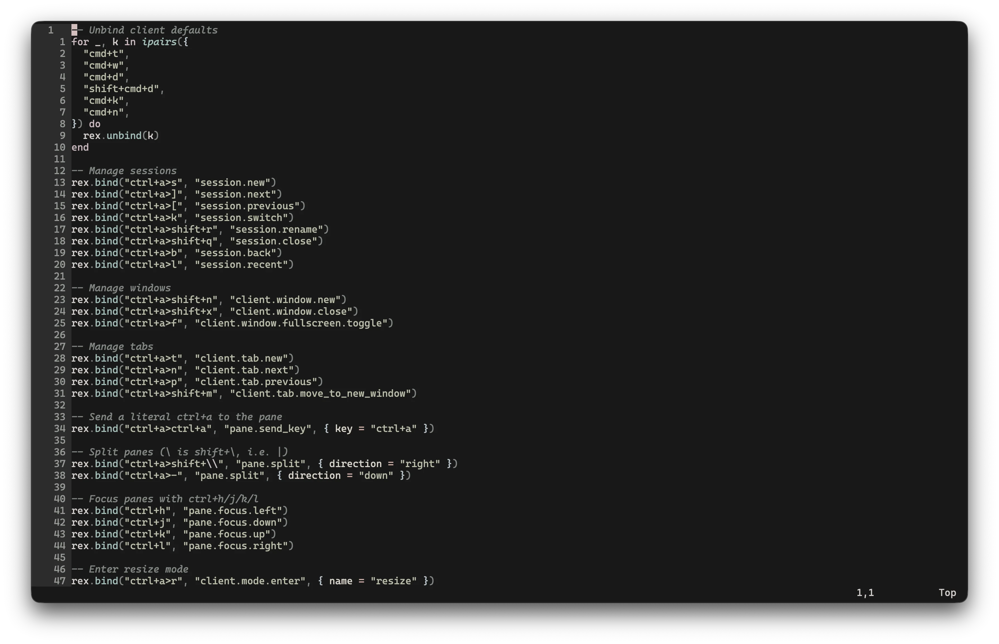

# Rex Personal Configuration

Personal config for testing, tweaking, and exploring
[Rex beta](https://www.superlogical.com/rex/docs/installation).



## Layout

```text
init.lua            # entry point, loads the modules under config/
config/keymaps.lua  # key bindings
```

## iOS Settings

### Themes

[kasumi.nvim](https://github.com/ryanjayleyva/kasumi.nvim/blob/main/extras/ghostty/kasumi)

Import the kasumi theme into Rex.

## Keybindings

The prefix is `ctrl+a`. Chords are written `ctrl+a>key`.

| Area     | Binding                                    | Action                                    |
| -------- | ------------------------------------------ | ----------------------------------------- |
| Sessions | `s` `]` `[` `k` `b` `l`                    | new, next, previous, switch, back, recent |
| Sessions | `shift+r` `shift+q`                        | rename, close                             |
| Windows  | `shift+n` `shift+x` `f`                    | new, close, toggle fullscreen             |
| Tabs     | `t` `n` `p` `shift+m`                      | new, next, previous, move to new window   |
| Panes    | `shift+\` (`\|`) `-`                       | split right, split down                   |
| Panes    | `ctrl+a` `ctrl+a`                          | send a literal `ctrl+a` to the pane       |
| Panes    | `ctrl+h` `ctrl+j` `ctrl+k` `ctrl+l`        | focus left, down, up, right (no prefix)   |
| Resize   | `ctrl+a>r`, then `h` `j` `k` `l`, `ctrl+q` | enter resize mode, resize, exit           |

The default client bindings `cmd+t`, `cmd+w`, `cmd+d`, `shift+cmd+d`, `cmd+k`,
and `cmd+n` are unbound.

## CLI Commands

Validate the configuration with the CLI

```bash
rex config check
```

Reload the configuration with the CLI

```bash
rex config reload
```

Thanks to [Rex](https://www.superlogical.com/rex/docs/customize/keyboard-shortcuts#removing-a-shortcut)
for the beta testing access!
